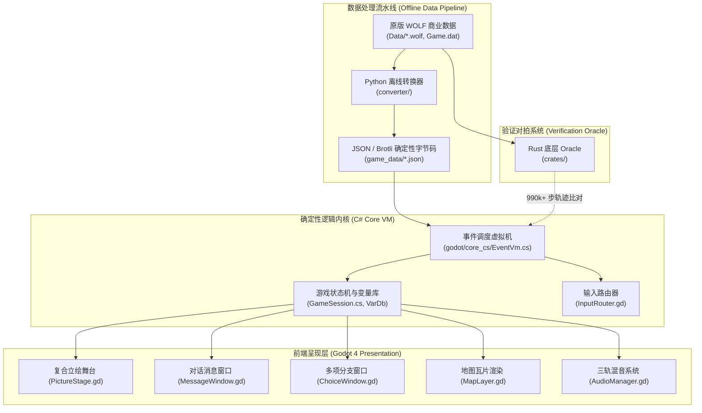

<div align="center">

# 《妹相随～黑白世界的缤纷冒险～》现代重构引擎

[English](README_EN.md) | [简体中文](README.md)

<p align="center">
  <a href="https://dotnet.microsoft.com/"></a>
  <a href="https://godotengine.org/"></a>
  <a href="#"></a>
  <a href="CHANGELOG.md"></a>
  <a href="tools/godot_check.sh"></a>
  <a href="DISCLAIMER.md"></a>
  <a href="docs/README.md"></a>
</p>

《妹相随～黑白世界的缤纷冒险～》（Living With Sister: Monochrome Fantasy，いぬすく 2023）的高性能现代化重构运行时。

基于 **Godot 4.7.2 Mono** 架构（**.NET 8 C# 确定性事件内核** + **GDScript 呈现层**），实现对 WOLF RPG 原版底层逻辑与音画行为的 100% 像素级对齐，同时提供高分辨率无级缩放、平滑帧率、多端触控与现代化键鼠交互。

> ⚠️ **注意**：本项目为**非商业性同人重构与逆向工程研究项目**，**不采用任何开源许可证**（保留所有权利）。仓库仅包含代码与文档，严禁分发任何商业游戏美术或音频资源。详见 [版权与免责声明](#-版权与免责声明)。

</div>

---

## 📑 目录

- [✨ 核心亮点](#-核心亮点)
- [🏛️ 系统架构](#️-系统架构)
- [📁 仓库目录结构](#-仓库目录结构)
- [🎮 玩家下载与运行指南](#-玩家下载与运行指南)
- [🛠️ 开发者源码构建与测试](#️-开发者源码构建与测试)
- [📚 文档导航中心](#-文档导航中心)
- [🤝 参与贡献](#-参与贡献)
- [📄 版权与免责声明](#-版权与免责声明)

---

## ✨ 核心亮点

- **⚡ 确定性 C# 事件虚拟机（Event VM）**
  - 自研高性能字节码虚拟机，严格保障无帧率依赖的绝对确定性执行。
  - 100% 复刻原版全部 **550 个公共事件**、**73 个地图事件** 与 **169,831 条底层逻辑指令**。
- **🎨 复合差分立绘高保真还原**
  - 像素级还原 WOLF 引擎数十层复合差分立绘叠加、图层变换、色调滤镜与 Alpha 混合公式。
  - 完备支持富文本排版、动态换行、字体缩放与黑边描边样式。
- **📱 全平台现代化体验与触控优化**
  - 支持 **Windows 桌面**、**Android** 与 **iOS** 移动端原生运行。
  - 移动端原生触控手势优化：双击空白取消、7 级层级返回、长按快进与存档翻页箭头热区。
  - 桌面端原生键鼠交互：**右键 / Esc / 空格** 统一取消，**滚轮 / 可点击翻页箭头** 快速选择与存档翻页。
- **💾 原版存档无缝双向互导**
  - 完备兼容原版 `.sav` 二进制存档文件结构，支持老存档直接载入与跨平台互导。
  - 现代化原子写入快照机制（VM 状态 / 对话日志 / 三轨音频），彻底杜绝坏档。
- **🗜️ 极致包体压缩与零开销分发**
  - 引入无损 Brotli 高压缩数据流水线，字节码与数据库体积缩减 **80%+**。
  - 配合定制裁剪的 2D / GLES3 + Mono 极简导出模板，实现最小化资源占用与秒级冷启动。
- **🛡️ 严苛的 38 道自动化质量门禁**
  - 内置 **38 道自动化严格交付门禁**，覆盖无头模式（Headless）与窗口全链路冒烟测试。
  - 依托底层 Rust Oracle 对账系统，**990,000+ 步** 长程全路线追踪与原版 100% 字节级一致。

---

## 🏛️ 系统架构

本项目采用**离线编译预处理 + 确定性 C# 逻辑内核 + Godot 表现层 + Oracle 对账基线**的清晰解耦架构：



---

## 📁 仓库目录结构

```text
Living-With-Sister-Monochrome-Fantasy/
├── .github/                 # GitHub Actions 自动化 CI 流水线与 Issue/PR 模版
├── converter/               # Python 离线数据工具：将 WOLF 原始二进制转换为 JSON 字节码
├── crates/                  # Rust 格式解析库与底层 Oracle 对拍验证基线
├── docs/                    # 完整工程技术规范、架构决策与排查报告
│   ├── engine/              # WOLF Opcode 指令集规格与底层契约
│   ├── godot/               # Godot 阶段权威入口与 D-01..D-86 架构决策
│   ├── milestones/          # M1 至 M13 各阶段交付记录
│   ├── plans/               # 顶层演进路线图与架构重构方案
│   ├── release/             # 资产审计与全流程打包指南
│   ├── research/            # 逆向实验与前置调研底稿
│   └── reviews/             # 系统性代码审查报告与缺陷排查台账（44 篇）
├── game_data/               # 转换后的 JSON 字节码与数据库（受保护，不含商业素材）
├── godot/                   # Godot 4.7.2 Mono 主工程
│   ├── core_cs/             # .NET 8 C# 确定性事件虚拟机与核心状态机
│   ├── presentation_gd/     # GDScript 表现层（立绘、选项、消息、地图、音频）
│   ├── scenes/              # 场景树节点与预设
│   └── Lwsmf.csproj         # C# 工程项目定义文件
├── oracle/                  # Oracle 运行轨迹夹具与双向差分核验工具
├── tools/                   # 自动化门禁测试（godot_check.sh）、打包、多端构建与分析工具
│   ├── cheat_engine/        # 逆向工程内存分析表与 618 具名变量偏移对照表
│   ├── installer/           # Windows Inno Setup 安装包模板
│   ├── mobile/              # Android / iOS 移动端打包与环境体检工具
│   ├── templates/           # 自定义 2D / GLES3 导出模板构建脚本
│   └── translation/         # 多语言本地化流水线
├── .editorconfig            # 统一代码风格与缩进规范
├── .gitattributes           # 统一 LF 换行规则与二进制文件声明
├── .gitignore               # 严格的受保护商业资产与构建生成物隔离规则
├── AGENTS.md                # 自动化开发智能体（AI Agents）协作约定
├── CHANGELOG.md             # 遵循语义化版本控制的工程更新日志
├── CONTRIBUTING.md          # 开发者贡献与代码规范指南
└── DISCLAIMER.md            # 知识产权免责声明与商业资产隔离原则
```

---

## 🎮 玩家下载与运行指南

### 1. 获取发行包

请前往 [Releases 页面](https://github.com/Nana7mi0721/Living-With-Sister-Monochrome-Fantasy/releases) 下载适合您平台的最新版本（当前版本：`M5 Preview`）。

- **Windows 独立便携版**：解压 `LWSMF-<版本>-windows-x64.zip` 至任意本地非中文目录。
- **Android 安装包**：下载 `LWSMF-<版本>-android-arm64.apk` 安装至设备。
- **iOS 包**：下载 `LWSMF-<版本>-ios-arm64.ipa`，按现有无签名/sideload 流程安装。

Windows 版产品名为“妹相随～黑白世界的缤纷冒险～”，Android/iOS 显示名为“妹相随”。

### 2. 准备游戏数据

> **重要说明**：根据版权与商业资产隔离原则，本重制版仓库为纯净运行时引擎，**绝不分发任何商业游戏美术与音频资源**。

首次运行前，请确保您已在 Steam 上合法购买并安装正版游戏：
1. 访问原版游戏安装目录（默认路径：`SteamLibrary/steamapps/common/Living With SIster Monochrome Fantasy`）；
2. 运行工程内置的数据转换脚本提取素材并生成运行时数据包；
3. 双击 `game\Lwsmf.exe` 即可畅享高帧率、无级缩放的重制版体验。

---

## 🛠️ 开发者源码构建与测试

### 环境依赖

- **操作系统**：Windows 10/11 x64、macOS 或 Linux
- **.NET SDK**：[.NET 8.0 SDK](https://dotnet.microsoft.com/download/dotnet/8.0)
- **Godot 引擎**：[Godot 4.7.2 stable Mono](https://godotengine.org/download)（请确保环境变量包含 `GODOT` 或配置 `GODOT_BIN`）
- **Python 环境**：Python 3.10+
- **Rust 工具链**（可选）：Stable（用于维护 Rust Oracle 测试基线）

### 本地编译

```bash
# 1. 克隆代码仓库
git clone https://github.com/Nana7mi0721/Living-With-Sister-Monochrome-Fantasy.git
cd Living-With-Sister-Monochrome-Fantasy

# 2. 编译 Godot C# 核心库（0 errors, 0 warnings）
dotnet build godot/Lwsmf.csproj -c Release
```

### 运行自动化质量门禁

```bash
# 执行全量 38 项自动化测试（无头模式 + 渲染模式）
bash tools/godot_check.sh
```

---

## 📚 文档导航中心

本工程沉淀了数百篇高质量技术契约与架构决策，全量导航请访问：
👉 **[全局文档导航中心 (docs/README.md)](docs/README.md)**

| 专题领域 | 入口文档 | 核心内容 |
| :--- | :--- | :--- |
| **架构决策** | [docs/godot/DECISIONS.md](docs/godot/DECISIONS.md) | D-01 至 D-93 核心拍板决策，定义 C# 内核与 GDScript 分工 |
| **执行计划** | [docs/godot/PLAN.md](docs/godot/PLAN.md) | M0 至 M5 路线规划与最终发布验收标准 |
| **引擎规范** | [docs/engine/README.md](docs/engine/README.md) | WOLF Opcode 指令集规格、格式契约与系统规范 |
| **审查台账** | [docs/reviews/README.md](docs/reviews/README.md) | 代码审查、全量审计与多平台修复台账 |
| **资产审计** | [docs/release/ASSET_AUDIT.md](docs/release/ASSET_AUDIT.md) | 2,215 项图片、316 项音频与 Steam 23 个 `.wolf` 数据包审计 |
| **智能体协作** | [AGENTS.md](AGENTS.md) | 并行研发、文件作用域隔离与门禁规范 |

---

## 🤝 参与贡献

欢迎对经典游戏现代化重构与虚拟机技术感兴趣的开发者参与交流！
详细开发流程、代码风格规范与提交约定，请参阅 **[CONTRIBUTING.md](CONTRIBUTING.md)**。

---

## 📄 版权与免责声明

本项目为面向游戏引擎技术交流与跨平台虚拟机重构的**非商业性同人学习项目**，**不采用任何开源许可协议**（保留所有权利）：
- 原作游戏《妹相随～黑白世界的缤纷冒险～》及其所包含的全部角色、剧情、美术、音乐著作权均归原作者 **いぬすく (inusuku)** 所有；
- 本仓库仅包含自研代码与技术文档，绝不分发任何受版权保护的商业素材；用户必须合法持有正版游戏方可运行；
- 详细法律声明请阅读 **[DISCLAIMER.md](DISCLAIMER.md)**。
