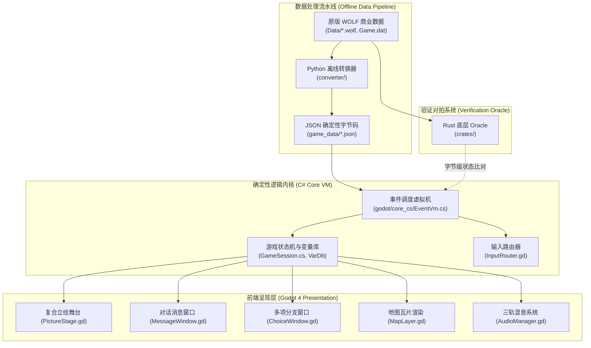

<div align="center">

# 《妹相随～黑白世界的缤纷冒险～》现代重构工程

[English](README_EN.md) | [简体中文](README.md)

<p align="center">
  <a href="https://dotnet.microsoft.com/"></a>
  <a href="https://godotengine.org/"></a>
  <a href="#"></a>
  <a href="CHANGELOG.md"></a>
  <a href="docs/README.md"></a>
</p>

《妹相随～黑白世界的缤纷冒险～》（Living With Sister: Monochrome Fantasy，いぬすく 2023）的高性能、现代化重构运行时。

基于 **Godot 4.7.2 Mono** 架构（**.NET 8 C# 确定性事件内核** + **GDScript 渲染呈现层**），实现对 WOLF RPG 原版底层逻辑与音画行为的 100% 像素级对齐，同时提供高分辨率无级缩放、平滑帧率与现代化键鼠交互。

</div>

---

## 📑 目录

- [✨ 核心特性](#-核心特性)
- [🏛️ 系统架构](#️-系统架构)
- [📁 仓库目录结构](#-仓库目录结构)
- [🎮 玩家下载与运行指南](#-玩家下载与运行指南)
- [🛠️ 开发者源码构建与测试](#️-开发者源码构建与测试)
- [📚 文档导航中心](#-文档导航中心)
- [🤝 参与贡献](#-参与贡献)
- [📄 版权与免责说明](#-版权与免责说明)

---

## ✨ 核心特性

- **🖥️ 现代化跨平台引擎底座**
  - 基于 Godot 4.7.2 Mono 64位运行时构建，彻底告别原版 32 位老旧执行环境。
  - 支持任意窗口比例无级缩放、全屏抗撕裂平滑渲染与现代化高帧率呈现。
- **⚡ 确定性 C# 事件虚拟机（Event VM）**
  - 自研高性能字节码虚拟机，严格保障无帧率依赖的绝对确定性执行。
  - 完美复刻原版全部 **550 个公共事件**、**73 个地图事件** 与 **169,831 条底层逻辑指令**。
- **🎨 复合差分立绘高保真还原**
  - 100% 像素级复现 WOLF 引擎特有的数十层复合差分立绘叠加、图层变换与 Alpha 混合公式。
  - 完备支持富文本排版、字体缩放与黑边描边样式。
- **💾 原版存档无缝往返**
  - 完备兼容原版 `.sav` 二进制存档文件结构，支持老存档导入与跨世代无损续跑。
  - 现代化三轨（VM / 对话 / 音频）运行时状态原子化持久化快照。
- **🎮 键鼠与手柄现代化交互**
  - 原生支持 **鼠标右键 / Esc / 空格** 统一取消与快速返回。
  - 支持 **鼠标滚轮** 与 **方向键** 进行选项预选、选单滚动与存档栏位翻页。
- **🔍 自动化质量门禁与 Oracle 对拍**
  - 内置 **38 道自动化严格交付门禁**，覆盖无头（Headless）与窗口全链路冒烟测试。
  - 依托底层 Rust Oracle 对账系统，确保每一条关键指令的状态变迁与原版零误差。

---

## 🏛️ 系统架构

本项目采用**离线编译预处理 + 确定性 C# 逻辑内核 + Godot 表现层**的清晰三层解耦架构：



---

## 📁 仓库目录结构

```text
Living-With-Sister-Monochrome-Fantasy/
├── .github/                 # GitHub Actions 自动化 CI 流水线与 Issue/PR 模版
├── converter/               # Python 离线转换工具：将 WOLF 原始字节码转换为 JSON
├── godot/                   # Godot 4.7.2 Mono 主工程
│   ├── core_cs/             # .NET 8 C# 确定性事件虚拟机与核心状态机
│   ├── presentation_gd/     # GDScript 表现层（立绘、选项、消息、地图、输入）
│   └── Lwsmf.csproj         # C# 工程项目定义文件
├── crates/                  # Rust 格式解析库与 Oracle 对拍验证基线
├── game_data/               # 离线转换后的 JSON 字节码、数据库与清单（不含商业美术）
├── cheat_engine/            # 逆向工程内存分析表与 618 具名变量偏移对照表
├── docs/                    # 完整工程技术规范、架构决策与排查报告
│   ├── engine/              # WOLF Opcode 指令集规格与底层契约
│   ├── frontend/            # Godot 呈现层规范与迁移技术指南
│   ├── godot/               # Godot 阶段权威入口与 D-01..D-53 架构决策
│   ├── milestones/          # M1 至 M13 各阶段交付记录
│   ├── plans/               # 顶层演进路线图与架构重构方案
│   ├── reviews/             # 系统性代码审查报告与缺陷排查台账
│   ├── release/             # 资产审计与全流程打包指南
│   ├── guide/               # 游戏原版流程攻略与数值百科
│   └── research/            # 逆向实验与前置调研底稿
├── tools/                   # 自动化门禁测试（godot_check.sh）、打包与构建脚本
├── .editorconfig            # 统一代码风格与缩进规范
├── .gitattributes           # 统一 LF 换行规则与二进制文件声明
├── .gitignore               # 严格的受保护商业资产与构建生成物隔离规则
├── AGENTS.md                # 自动化开发智能体（AI Agents）协作约定
├── CHANGELOG.md             # 遵循语义化版本控制的工程更新日志
├── CONTRIBUTING.md          # 开发者贡献指南
└── DISCLAIMER.md            # 知识产权免责声明与商业资产隔离原则
```

---

## 🎮 玩家下载与运行指南

### 1. 获取发行包

请前往 [Releases 页面](https://github.com/Nana7mi0721/Living-With-Sister-Monochrome-Fantasy/releases) 下载适合您平台的最新版本（当前版本：`M5 Preview`）。

- **独立便携版**：解压 `LWSMF-Remake-windows-x64.zip` 至任意本地非中文目录。

### 2. 准备游戏数据

> **重要说明**：根据版权与商业资产隔离原则，本重制版仓库为纯净运行时引擎，**绝不分发任何商业游戏美术与音频资源**。

首次运行前，请确保您已在 Steam 上合法购买并安装正版游戏：
1. 访问原版游戏安装目录（默认路径：`SteamLibrary/steamapps/common/Living With SIster Monochrome Fantasy`）；
2. 运行工程内置的数据转换脚本提取素材并生成运行时数据包；
3. 双击 `LWSMF.exe` 即可畅享高帧率、无级缩放的重制版体验。

---

## 🛠️ 开发者源码构建与测试

### 环境依赖

- **操作系统**：Windows 10/11 x64
- **.NET SDK**：[.NET 8.0 SDK](https://dotnet.microsoft.com/download/dotnet/8.0)
- **Godot 引擎**：[Godot 4.7.2 stable Mono](https://godotengine.org/download)（请确保环境变量包含 `GODOT` 或配置 `GODOT_BIN`）
- **Python 环境**：Python 3.10+
- **Rust 工具链**（可选）：Stable（用于维护 Rust Oracle 测试基线）

### 本地编译

```bash
# 1. 克隆代码仓库
git clone https://github.com/Nana7mi0721/Living-With-Sister-Monochrome-Fantasy.git
cd Living-With-Sister-Monochrome-Fantasy

# 2. 编译 Godot C# 核心库
dotnet build godot/Lwsmf.csproj -c Release
```

### 运行自动化质量门禁

```bash
# 执行全量 38 项自动化测试（无头模式 + 窗口模式）
bash tools/godot_check.sh
```

---

## 📚 文档导航中心

本工程沉淀了数百篇高质量技术契约与架构决策，全量导航请访问：
👉 **[全局文档导航中心 (docs/README.md)](docs/README.md)**

| 专题领域 | 入口文档 | 核心内容 |
| :--- | :--- | :--- |
| **架构决策** | [docs/godot/DECISIONS.md](docs/godot/DECISIONS.md) | D-01 至 D-53 核心拍板决策，定义 C# 内核与 GDScript 分工 |
| **当前路线** | [docs/plans/PLAN.md](docs/plans/PLAN.md) | M0 至 M5 路线规划与最终发布验收标准 |
| **引擎规范** | [docs/engine/README.md](docs/engine/README.md) | WOLF Opcode 指令集规格、格式契约与系统规范 |
| **缺陷审查** | [docs/reviews/bug_inspection_report_2026_11_20.md](docs/reviews/bug_inspection_report_2026_11_20.md) | 最新核心缺陷排查报告（右键输入、素材缺失、文本解析） |
| **资产审计** | [docs/release/ASSET_AUDIT.md](docs/release/ASSET_AUDIT.md) | 2,215 项图片、316 项音频与 Steam 23 个 `.wolf` 数据包审计 |
| **智能体协作** | [AGENTS.md](AGENTS.md) | 并行研发、文件作用域隔离与门禁规范 |

---

## 🤝 参与贡献

欢迎对经典游戏现代化重构感兴趣的开发者提交 Issue 或 Pull Request！
详细开发流程、代码风格规范与提交约定，请参阅 **[CONTRIBUTING.md](CONTRIBUTING.md)**。

---

## 📄 版权与免责说明

本项目为面向游戏引擎技术交流与跨平台虚拟机重构的**非商业性开源学习项目**：
- 原作游戏《妹相随～黑白世界的缤纷冒险～》及其所包含的全部美术、音乐、文本著作权均归原作者 **いぬすく (inusuku)** 所有；
- 本仓库仅包含开源的代码与技术文档，严禁分发任何商业受限资产；
- 详细法律声明请阅读 **[DISCLAIMER.md](DISCLAIMER.md)**。
