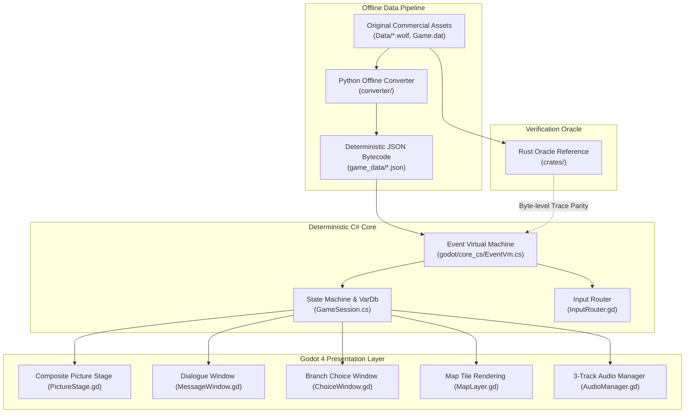

<div align="center">

# Living With Sister: Monochrome Fantasy — Modern Remake Runtime

[English](README_EN.md) | [简体中文](README.md)

<p align="center">
  <a href="https://dotnet.microsoft.com/"></a>
  <a href="https://godotengine.org/"></a>
  <a href="#"></a>
  <a href="CHANGELOG.md"></a>
  <a href="docs/README.md"></a>
</p>

A high-performance, modern reimplementation and cross-platform runtime for *Living With Sister: Monochrome Fantasy* (妹相随～黑白世界的缤纷冒险～, inusuku 2023).

Powered by **Godot 4.7.2 Mono** with a **.NET 8 C# deterministic Event VM** and a **GDScript presentation layer**, achieving 100% pixel-level parity with the original WOLF RPG bytecode semantics while delivering arbitrary window scaling, smooth frame rates, and modernized controls.

</div>

---

## 📑 Table of Contents

- [✨ Key Features](#-key-features)
- [🏛️ System Architecture](#️-system-architecture)
- [📁 Repository Structure](#-repository-structure)
- [🎮 Player Quick Start & Asset Setup](#-player-quick-start--asset-setup)
- [🛠️ Developer Build & Test Guide](#️-developer-build--test-guide)
- [📚 Documentation Index](#-documentation-index)
- [🤝 Contributing](#-contributing)
- [📄 Disclaimer & Legal Notice](#-disclaimer--legal-notice)

---

## ✨ Key Features

- **🖥️ Modern 64-bit Engine Foundation**
  - Built on Godot 4.7.2 Mono (64-bit), moving away from the legacy 32-bit execution environment.
  - Supports arbitrary resolution aspect-ratio scaling, tear-free rendering, and high-framerate displays.
- **⚡ Deterministic C# Event Virtual Machine**
  - Custom bytecode interpreter running completely independent of frame rates.
  - Accurately executes all **550 common events**, **73 map events**, and **169,831 low-level opcodes**.
- **🎨 High-Fidelity Composite Sprite Rendering**
  - Pixel-perfect reproduction of WOLF RPG multi-layered character sprites, transform matrices, and alpha blending.
  - Full support for rich text tokenization, font sizing, and outline rendering styles.
- **💾 Seamless Original Save Interoperability**
  - Full bidirectional compatibility with original `.sav` binary files and variable databases.
  - Atomic persistence snapshots covering VM state, dialogue logs, and multi-track audio.
- **🎮 Modernized Input & Controls**
  - Native **Right-Click / Esc / Space** mapping for intuitive cancel/back actions.
  - **Mouse Wheel** and **Arrow Keys** support for option preview, list scrolling, and save slot paging.
- **🔍 Automated Quality Gates & Oracle Trace Parity**
  - **38 strict automated CI gates** testing headless runs, state transitions, and rendering parity.
  - Backed by an underlying Rust Oracle ensuring zero deviation on bytecode semantics.

---

## 🏛️ System Architecture

The project features a decoupled three-tier architecture:



---

## 📁 Repository Structure

```text
Living-With-Sister-Monochrome-Fantasy/
├── .github/                 # GitHub Actions CI workflow & Issue/PR templates
├── converter/               # Python tool compiling WOLF binary data into JSON bytecode
├── godot/                   # Godot 4.7.2 Mono project root
│   ├── core_cs/             # .NET 8 C# deterministic Event VM and state machines
│   ├── presentation_gd/     # GDScript UI, rendering, and input handling
│   └── Lwsmf.csproj         # C# project definition
├── crates/                  # Rust format parsers & Oracle verification baseline
├── game_data/               # Converted JSON bytecode & databases (assets excluded)
├── cheat_engine/            # CE tables and 618 variable offset mappings for research
├── docs/                    # Complete technical specifications & audit reports
│   ├── engine/              # WOLF opcode specifications & low-level contracts
│   ├── frontend/            # Godot frontend architecture & migration specs
│   ├── godot/               # Authoritative Godot documentation & D-01..D-53 decisions
│   ├── milestones/          # M1 to M13 milestone progress and delivery logs
│   ├── plans/               # High-level architecture plans and RFCs
│   ├── reviews/             # Systematic code review reports and bug audit records
│   ├── release/             # Asset audit and packaging guides
│   ├── guide/               # Game walkthroughs and formula databases
│   └── research/            # Reverse engineering experimental notes
├── tools/                   # Automated check scripts (godot_check.sh), packaging, and tooling
├── .editorconfig            # Code style and indentation guidelines
├── .gitattributes           # Git line ending normalization (LF)
├── .gitignore               # Strict commercial asset & build artifact isolation
├── AGENTS.md                # Collaboration guidelines for AI coding agents
├── CHANGELOG.md             # Semantic versioning changelog
├── CONTRIBUTING.md          # Developer contribution guide
└── DISCLAIMER.md            # Copyright disclaimer and non-commercial research terms
```

---

## 🎮 Player Quick Start & Asset Setup

### 1. Download Release
Download the latest release from the [Releases Page](https://github.com/Nana7mi0721/Living-With-Sister-Monochrome-Fantasy/releases).

### 2. Prepare Game Assets
> **Notice**: To respect copyright and asset isolation principles, this repository provides only the pure open-source engine runtime. **No commercial graphics or audio files are distributed**.

Before running the game:
1. Ensure you have legitimately purchased and installed the original game via Steam (`SteamLibrary/steamapps/common/Living With SIster Monochrome Fantasy`).
2. Run the offline converter to extract media and generate the local runtime data pack.
3. Launch `LWSMF.exe` to enjoy the modernized remake.

---

## 🛠️ Developer Build & Test Guide

### Prerequisites
- **OS**: Windows 10/11 x64
- **.NET SDK**: [.NET 8.0 SDK](https://dotnet.microsoft.com/download/dotnet/8.0)
- **Godot Engine**: [Godot 4.7.2 stable Mono](https://godotengine.org/download)
- **Python**: Python 3.10+
- **Rust Toolchain** (Optional): Stable (for the Oracle verification baseline)

### Build from Source
```bash
# Clone the repository
git clone https://github.com/Nana7mi0721/Living-With-Sister-Monochrome-Fantasy.git
cd Living-With-Sister-Monochrome-Fantasy

# Build the C# core library
dotnet build godot/Lwsmf.csproj -c Release
```

### Run Automated Quality Gates
```bash
# Run all 38 automated test gates (headless + windowed smoke tests)
bash tools/godot_check.sh
```

---

## 📚 Documentation Index

For exhaustive technical references, see the **[Global Documentation Map (docs/README.md)](docs/README.md)**:

| Category | Document | Description |
| :--- | :--- | :--- |
| **Decisions** | [docs/godot/DECISIONS.md](docs/godot/DECISIONS.md) | Authoritative architectural decisions D-01 through D-53 |
| **Roadmap** | [docs/plans/PLAN.md](docs/plans/PLAN.md) | M0 to M5 roadmap and release criteria |
| **Engine Specs** | [docs/engine/README.md](docs/engine/README.md) | WOLF opcode semantics, binary formats, and subsystems |
| **Bug Audits** | [docs/reviews/bug_inspection_report_2026_11_20.md](docs/reviews/bug_inspection_report_2026_11_20.md) | In-depth audit report on input bugs, asset missing, and text tokenization |
| **Asset Audit** | [docs/release/ASSET_AUDIT.md](docs/release/ASSET_AUDIT.md) | Inventory of 2,215 graphics, 316 audio files, and 23 `.wolf` archives |

---

## 🤝 Contributing

Contributions are welcome! Please read **[CONTRIBUTING.md](CONTRIBUTING.md)** for our development workflow, coding standards, and commit conventions.

---

## 📄 Disclaimer & Legal Notice

This project is an **independent, non-commercial research and educational endeavor**:
- All characters, narrative, music, and art assets of *Living With Sister: Monochrome Fantasy* are the intellectual property of the original creator, **inusuku (いぬすく)**.
- This repository contains strictly open-source code and technical documentation.
- For complete terms, please read **[DISCLAIMER.md](DISCLAIMER.md)**.
