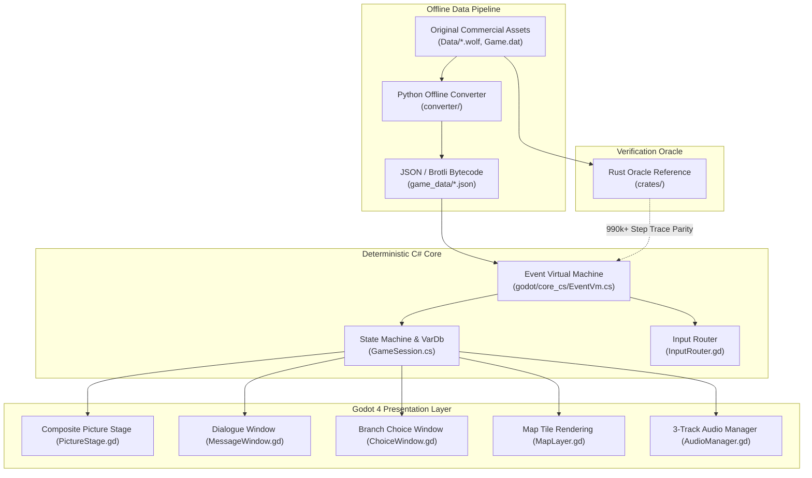

<div align="center">

# Living With Sister: Monochrome Fantasy — Modern Remake Runtime

[English](README_EN.md) | [简体中文](README.md)

<p align="center">
  <a href="https://dotnet.microsoft.com/"></a>
  <a href="https://godotengine.org/"></a>
  <a href="#"></a>
  <a href="CHANGELOG.md"></a>
  <a href="tools/godot_check.sh"></a>
  <a href="DISCLAIMER.md"></a>
  <a href="docs/README.md"></a>
</p>

A high-performance, modern reimplementation and cross-platform runtime for *Living With Sister: Monochrome Fantasy* (妹相随～黑白世界的缤纷冒险～, inusuku 2023).

Powered by **Godot 4.7.2 Mono** with a **.NET 8 C# deterministic Event VM** and a **GDScript presentation layer**, achieving 100% pixel-level parity with original WOLF RPG bytecode semantics while delivering arbitrary window scaling, smooth frame rates, mobile touch support, and modernized controls.

> ⚠️ **Notice**: This project is a **non-commercial fan recreation and reverse-engineering research project**, and is **NOT licensed under any open-source license** (all rights reserved). This repository contains only code and technical documentation; no commercial assets are distributed. See [Disclaimer & Legal Notice](#-disclaimer--legal-notice).

</div>

---

## 📑 Table of Contents

- [✨ Key Features](#-key-features)
- [🏛️ System Architecture](#️-system-architecture)
- [📁 Repository Structure](#-repository-structure)
- [🎮 Player Quick Start & Asset Setup](#-player-quick-start--asset-setup)
- [🛠️ Developer Build & Test Guide](#️-developer-build--test-guide)
- [📚 Documentation Index](#-documentation-index)
- [🤝 Contributing](#-contributing)
- [📄 Disclaimer & Legal Notice](#-disclaimer--legal-notice)

---

## ✨ Key Features

- **⚡ Deterministic C# Event Virtual Machine**
  - Custom bytecode interpreter running completely independent of frame rates.
  - Faithfully executes all **550 common events**, **73 map events**, and **169,831 low-level opcodes**.
- **🎨 High-Fidelity Composite Sprite Rendering**
  - Pixel-perfect reproduction of WOLF RPG multi-layered character sprites, transform matrices, color filters, and alpha blending.
  - Complete support for rich text tokenization, dynamic wrapping, font scaling, and border outline rendering.
- **📱 Cross-Platform Modernization & Touch Controls**
  - Native builds for **Windows Desktop**, **Android**, and **iOS**.
  - Mobile touch UX: Double-tap cancel, 7-level back navigation, long-press fast forward, and touch-adapted menus.
  - Desktop controls: Unified **Right-Click / Esc / Space** back action, **Mouse Wheel** option preview and save slot scrolling.
- **💾 Seamless Bi-directional Save Migration**
  - Full bidirectional compatibility with original `.sav` binary files and variable databases.
  - Atomic persistence snapshot architecture (VM state, dialogue history, 3-track audio) preventing corrupted states.
- **🗜️ Ultra-compact Packaging & Fast Cold Start**
  - Integrated lossless Brotli compression pipeline reducing bytecode/database footprint by **over 80%**.
  - Custom stripped 2D/GLES3 + Mono export templates for low memory footprint and instant launch.
- **🛡️ 38 Automated Quality Gates & Oracle Trace Parity**
  - **38 strict automated CI gates** testing headless runs, state transitions, and rendering parity.
  - Backed by an underlying Rust Oracle ensuring **990,000+ steps** of trace parity with original game binaries.

---

## 🏛️ System Architecture

The project features a decoupled three-tier architecture:



---

## 📁 Repository Structure

```text
Living-With-Sister-Monochrome-Fantasy/
├── .github/                 # GitHub Actions CI workflow & Issue/PR templates
├── converter/               # Python tool compiling WOLF binary data into JSON bytecode
├── crates/                  # Rust format parsers & Oracle verification baseline
├── docs/                    # Complete technical specifications & audit reports
│   ├── engine/              # WOLF opcode specifications & low-level contracts
│   ├── godot/               # Authoritative Godot documentation & D-01..D-86 decisions
│   ├── milestones/          # M1 to M13 milestone progress and delivery logs
│   ├── plans/               # High-level architecture plans and RFCs
│   ├── release/             # Asset audit and packaging guides
│   ├── research/            # Reverse engineering experimental notes
│   └── reviews/             # Systematic code review reports and bug audit records (44 reports)
├── game_data/               # Converted JSON bytecode & databases (assets excluded)
├── godot/                   # Godot 4.7.2 Mono project root
│   ├── core_cs/             # .NET 8 C# deterministic Event VM and state machines
│   ├── presentation_gd/     # GDScript UI, rendering, and input handling
│   ├── scenes/              # Scene tree nodes and presets
│   └── Lwsmf.csproj         # C# project definition
├── oracle/                  # Oracle trace fixtures and differential validation scripts
├── tools/                   # Automated check scripts (godot_check.sh), packaging, and tooling
│   ├── cheat_engine/        # CE tables and 618 variable offset mappings for research
│   ├── installer/           # Windows Inno Setup packaging scripts
│   ├── mobile/              # Android / iOS packaging and environment verification
│   ├── templates/           # Custom 2D / GLES3 export template pipelines
│   └── translation/         # Localization and text extraction pipeline
├── .editorconfig            # Code style and indentation guidelines
├── .gitattributes           # Git line ending normalization (LF)
├── .gitignore               # Strict commercial asset & build artifact isolation
├── AGENTS.md                # Collaboration guidelines for AI coding agents
├── CHANGELOG.md             # Semantic versioning changelog
├── CONTRIBUTING.md          # Developer contribution guide
└── DISCLAIMER.md            # Copyright disclaimer and non-commercial research terms
```

---

## 🎮 Player Quick Start & Asset Setup

### 1. Download Release
Download the latest release for your platform from the [Releases Page](https://github.com/Nana7mi0721/Living-With-Sister-Monochrome-Fantasy/releases).

- **Windows Portable**: Extract `LWSMF-Remake-windows-x64.zip` to any local non-ASCII folder.
- **Android APK**: Install `LWSMF-Remake-android.apk` on your device.

### 2. Prepare Game Assets
> **Notice**: To respect copyright and asset isolation principles, this repository provides only the engine runtime. **No commercial graphics or audio files are distributed**.

Before running the game:
1. Ensure you have legitimately purchased and installed the original game via Steam (`SteamLibrary/steamapps/common/Living With SIster Monochrome Fantasy`).
2. Run the offline converter to extract media and generate the local runtime data pack.
3. Launch `LWSMF.exe` to enjoy the modernized remake.

---

## 🛠️ Developer Build & Test Guide

### Prerequisites
- **OS**: Windows 10/11 x64, macOS, or Linux
- **.NET SDK**: [.NET 8.0 SDK](https://dotnet.microsoft.com/download/dotnet/8.0)
- **Godot Engine**: [Godot 4.7.2 stable Mono](https://godotengine.org/download)
- **Python**: Python 3.10+
- **Rust Toolchain** (Optional): Stable (for the Oracle verification baseline)

### Build from Source
```bash
# Clone the repository
git clone https://github.com/Nana7mi0721/Living-With-Sister-Monochrome-Fantasy.git
cd Living-With-Sister-Monochrome-Fantasy

# Build the C# core library (0 errors, 0 warnings)
dotnet build godot/Lwsmf.csproj -c Release
```

### Run Automated Quality Gates
```bash
# Run all 38 automated test gates (headless + windowed smoke tests)
bash tools/godot_check.sh
```

---

## 📚 Documentation Index

For exhaustive technical references, see the **[Global Documentation Map (docs/README.md)](docs/README.md)**:

| Category | Document | Description |
| :--- | :--- | :--- |
| **Decisions** | [docs/godot/DECISIONS.md](docs/godot/DECISIONS.md) | Authoritative architectural decisions D-01 through D-86 |
| **Execution Plan** | [docs/godot/PLAN.md](docs/godot/PLAN.md) | M0 to M5 roadmap and release criteria |
| **Engine Specs** | [docs/engine/README.md](docs/engine/README.md) | WOLF opcode semantics, binary formats, and subsystems |
| **Review Ledger** | [docs/reviews/README.md](docs/reviews/README.md) | 44 code reviews, bug audit logs, and platform remediation reports |
| **Asset Audit** | [docs/release/ASSET_AUDIT.md](docs/release/ASSET_AUDIT.md) | Inventory of 2,215 graphics, 316 audio files, and 23 `.wolf` archives |
| **Agent Standards** | [AGENTS.md](AGENTS.md) | AI workflow, write scope isolation, and delivery gates |

---

## 🤝 Contributing

Contributions and technical discussions are welcome! Please read **[CONTRIBUTING.md](CONTRIBUTING.md)** for our development workflow, coding standards, and commit conventions.

---

## 📄 Disclaimer & Legal Notice

This project is an **independent, non-commercial research and educational recreation**:
- All characters, narrative, music, and art assets of *Living With Sister: Monochrome Fantasy* are the intellectual property of the original creator, **inusuku (いぬすく)**.
- **No open-source license is granted** (all rights reserved). This repository contains only proprietary/research code and technical documentation. Users must legally own the original game to run the project.
- For complete terms, please read **[DISCLAIMER.md](DISCLAIMER.md)**.
