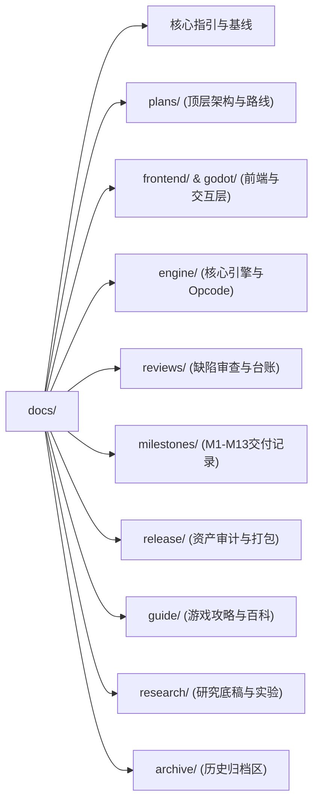

# 文档总索引导航中心（docs/README.md）

本文件是《妹相随～黑白世界的缤纷冒险～》重制版工程的**唯一全局文档导航中心**。所有设计规范、技术决策、Opcode 契约与审查报告按模块结构化归档：

---

## 0. 状态约定

| 状态标签 | 含义说明 |
| :--- | :--- |
| **现行 · 先读** | 现行且必须优先阅读的核心规范或入口文档 |
| **现行 · 权威** | 核心架构与逻辑事实来源，结论与数据可直接引用 |
| **现行 · 记录** | 现行的任务进度台账、缺陷排查或执行日志 |
| **历史证据** | 研发攻坚阶段的历史备忘与推导过程（以现行规范为准） |
| **已归档** | 已被新设计或总报告取代，保留作为历史证据链 |

---

## 1. 核心交接与现行规范（先读）

| 文档 | 状态 | 内容与定位 |
| :--- | :---: | :--- |
| [godot/README.md](godot/README.md) | **现行 · 先读** | **Godot 重制阶段唯一规范入口**：环境基线、当前完成状态与维护约定 |
| [godot/DECISIONS.md](godot/DECISIONS.md) | **现行 · 权威** | **定稿架构决策（D-01..D-53）**：确定采用纯 C# 确定性事件内核 + GDScript 呈现层 |
| [godot/PLAN.md](godot/PLAN.md) | **现行 · 权威** | Godot 阶段总体演进路线与 M0–M5 各阶段退出标准 |
| [BASELINE.json](BASELINE.json) | **现行 · 权威** | 自动化测试与一致性校验基线（包含 Game.dat 字段、公共事件、地图事件统计） |
| [ARCHITECTURE.md](ARCHITECTURE.md) | **现行 · 权威** | 全局架构设计方案（数据转换管线、运行时状态机、渲染层级） |
| [../AGENTS.md](../AGENTS.md) | **现行 · 必读** | 自动化开发与协作约定（写作用域隔离、测试门限要求、内容安全） |
| [../CONTRIBUTING.md](../CONTRIBUTING.md) | 现行 · 指南 | 开发者贡献指南（环境准备、源码构建、测试流程与规范约定） |
| [../CHANGELOG.md](../CHANGELOG.md) | 现行 · 历史 | 版本发布与变更日志（语义化版本控制） |
| [../DISCLAIMER.md](../DISCLAIMER.md) | 现行 · 法律 | 原作知识产权与非商业研究免责声明、纯代码与商业资产隔离原则 |

---

## 2. 顶层规划与演进方案（[plans/](plans/README.md)）

存放顶层演进路线图与重大架构重构方案：

- [plans/README.md](plans/README.md) — 方案目录索引
- [plans/PLAN.md](plans/PLAN.md) — **工程总体路线图**：涵盖 Rust Oracle 验证期至纯 Godot Mono 全流程里程碑划分与验收标准

---

## 3. 前端交互与展示层架构（[frontend/](frontend/README.md) & [godot/](godot/README.md)）

Godot 4.7.2 Mono 前端设计、视口呈现与运行时交互规范：

- [frontend/README.md](frontend/README.md) — 前端展示层总览与快速指引
- [godot/README.md](godot/README.md) — Godot 重制阶段权威入口
- [godot/DECISIONS.md](godot/DECISIONS.md) — 拍板决策集合（技术栈选型、无 C++ GDExtension 依赖）
- [godot/DATA_CONTRACT.md](godot/DATA_CONTRACT.md) — 离线转换数据契约（`programs.json`、`database.json`、`manifest.json`）
- [godot/M0_HANDOFF.md](godot/M0_HANDOFF.md) — M0 验收交接：环境门限、数据对账与 Oracle 对拍机制
- [godot/M1_HANDOFF.md](godot/M1_HANDOFF.md) — M1 验收交接：切片运行链、存读档续跑与视口管理
- [godot/M5_HANDOFF.md](godot/M5_HANDOFF.md) — M5 收口交接：发布包结构、运行时性能与长程 Soak 验证
- [godot/RELEASE.md](godot/RELEASE.md) — 发布与导出说明：构建流程、导出预设与实测记录
- [godot/LEGACY_RUST_AUDIT.md](godot/LEGACY_RUST_AUDIT.md) — 22 项旧 Rust 实现缺陷防范与 Godot 交互护栏

---

## 4. 核心引擎规范与行为契约（[engine/](engine/README.md)）

收拢底层字节码指令集（Opcode）、二进制格式与游戏子系统权威契约：

- [engine/README.md](engine/README.md) — 核心引擎规范导航索引
- [engine/OPCODE_SPEC.md](engine/OPCODE_SPEC.md) — **WOLF RPG 完整指令集架构总览**
- [engine/FORMAT_SPEC.md](engine/FORMAT_SPEC.md) — `Game.dat`、数据表与 DXArchive 二进制打包格式全景
- [engine/SAVE_SPEC.md](engine/SAVE_SPEC.md) — `.sav` 文件字节结构、变量库哈希、双向无损往返契约
- [engine/TEXT_SPEC.md](engine/TEXT_SPEC.md) — 文本转义标记与展开器行为规范
- [engine/ENGINE_EVENTS.md](engine/ENGINE_EVENTS.md) — 事件调度状态机与并发队列规范
- [engine/TIME_SYSTEM.md](engine/TIME_SYSTEM.md) — 游戏内时间流转与日程作息系统
- [engine/BATTLE.md](engine/BATTLE.md) — 回合制战斗状态机与数值结算规范
- [engine/PARTY_DB.md](engine/PARTY_DB.md) — 角色属性、成长与队伍数据库规范
- [engine/AUDIO.md](engine/AUDIO.md) — BGM/BGS/SE 三轨独立混音与生命周期管理
- [engine/HSCENE.md](engine/HSCENE.md) — 特殊场景多层立绘差分叠加与状态流转契约
- [engine/WOLF 按键输入命令语义核查.md](engine/WOLF%20按键输入命令语义核查.md) — 按键掩码与硬件输入映射核查

---

## 5. 代码审查与缺陷台账（[reviews/](reviews/README.md)）

系统性代码审查（Code Review）、跨仓库审计与缺陷追踪记录：

- [reviews/README.md](reviews/README.md) — 代码审查台账总览索引
- [reviews/deepseek_retail_mechanism_audit_2026_11_20.md](reviews/deepseek_retail_mechanism_audit_2026_11_20.md) — **现行·专题**：标题“开始/继续”、全新封面分支、Map003 时序与 Lolita 字体回退综合核查
- [reviews/deepseek_title_newgame_interaction_2026_11_20.md](reviews/deepseek_title_newgame_interaction_2026_11_20.md) — 标题菜单/新游戏入口/原版点击行为分项报告
- [reviews/deepseek_title_graphics_fresh_state_2026_11_20.md](reviews/deepseek_title_graphics_fresh_state_2026_11_20.md) — 全新状态封面与 CE42/Map003 选图分项报告
- [reviews/deepseek_font_fallback_chain_2026_11_20.md](reviews/deepseek_font_fallback_chain_2026_11_20.md) — DxLib 字体绑定与缺字回退分项报告
- [reviews/bug_inspection_report_2026_11_20.md](reviews/bug_inspection_report_2026_11_20.md) — **现行·重点**：右键点击失效、素材缺失、文本解析内部代号泄露深度审查报告
- [reviews/bug_fix_and_gate_opt_2026_11_20.md](reviews/bug_fix_and_gate_opt_2026_11_20.md) — **现行·记录**：输入/文本/VM 修复、Oracle 对齐与 38 项门禁并行加速总结
- [reviews/m5_round12_review_2026_11_19.md](reviews/m5_round12_review_2026_11_19.md) — M5 发布前夕全景审查与收口验证
- [reviews/m4_round11_review_2026_11_18.md](reviews/m4_round11_review_2026_11_18.md) — M4 对齐 Oracle 与长程 Soak 稳定性审查
- [reviews/m2w4_round5_repo_review_2026_11_15.md](reviews/m2w4_round5_repo_review_2026_11_15.md) — M2W4 仓库代码整洁度与模块依赖审计
- [reviews/imoto_life_title_and_layout_audit_report.md](reviews/imoto_life_title_and_layout_audit_report.md) — 跨仓库标题与布局像素对齐审计

---

## 6. 里程碑研发交付记录（[milestones/](milestones/README.md)）

攻坚期各里程碑阶段的交付记录与验收证据：

- [milestones/README.md](milestones/README.md) — 里程碑记录总览
- [milestones/M1_CLOSURE.md](milestones/M1_CLOSURE.md) — M1 启动切片收口
- [milestones/M2_SLICE.md](milestones/M2_SLICE.md) — M2 日常循环切片
- [milestones/HANDOFF_M3.md](milestones/HANDOFF_M3.md) 至 [milestones/HANDOFF_M13.md](milestones/HANDOFF_M13.md) — M3 到 M13 各阶段完整运行时交付记录

---

## 7. 资产审计与发布工具链（[release/](release/README.md)）

- [release/README.md](release/README.md) — 资产与工具链导航
- [release/ASSET_AUDIT.md](release/ASSET_AUDIT.md) — 游戏原始素材全景审计与解包规则
- [release/MAP_AUDIT.md](release/MAP_AUDIT.md) — 地图图块与事件热区审计
- [release/TOOLING.md](release/TOOLING.md) — 编译构建、离线转换与自动化脚本设计

---

## 8. 攻略与逆向研究区（[guide/](guide/README.md) & [research/](research/README.md)）

- [guide/README.md](guide/README.md) — 游戏攻略与百科全书索引
- [research/README.md](research/README.md) — 逆向实验、前置调研与技术底稿（含 50 余份 M6–M13 研究记录）
- [archive/README.md](archive/README.md) — 历史归档区（旧 Rust 规划与早期设计）
- [vendor/](vendor/) — 第三方分析与逆向工具包（WolfDec, WolfSave, WolfTL）
