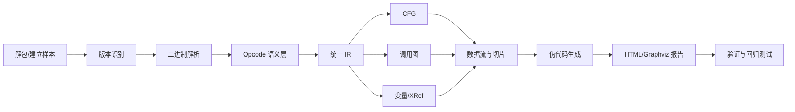
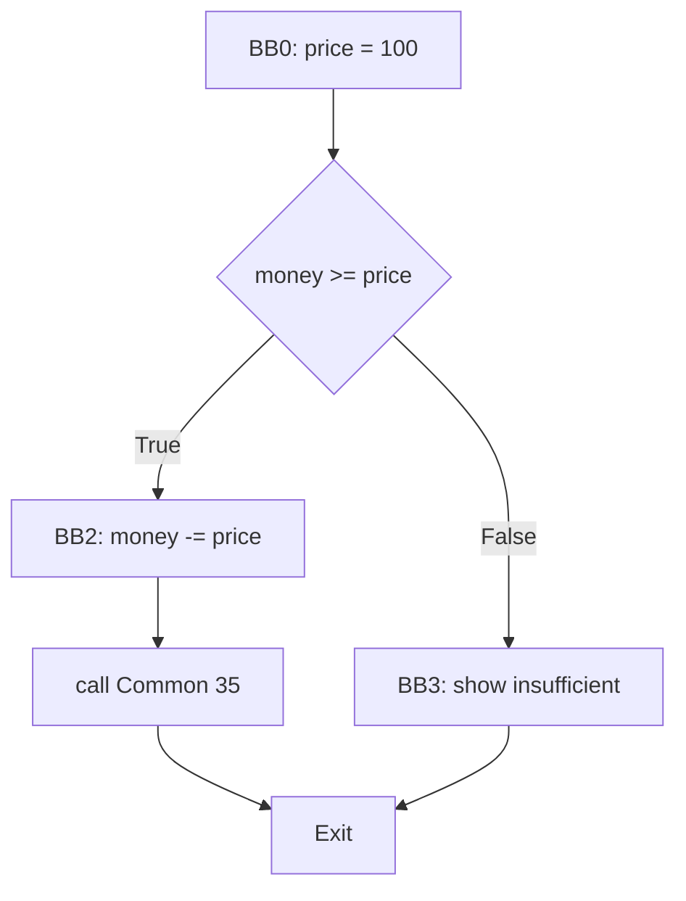
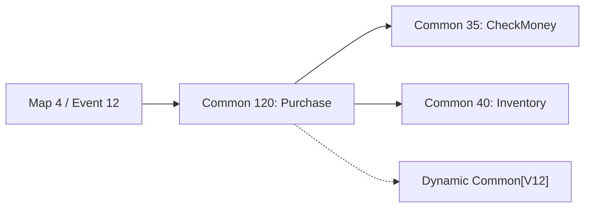
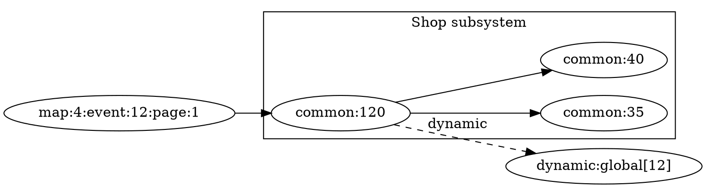

# 完整逆向 WOLF RPG Editor 事件逻辑并生成可读伪代码：可行性与实施报告

## Executive Summary

本报告的结论是：**完整逆向 WOLF RPG Editor（ウディタ）的“游戏事件逻辑”并生成高可读伪代码，是现实可行的，而且最合适的切入点不是 `Game.exe`，而是 `CommonEvent.dat`、地图 `.mps`、数据库文件以及事件命令参数。** WOLF RPG Editor 的核心游戏逻辑主要由固定编号的事件命令驱动；官方文档明确说明公共事件拥有调用参数、返回值、自动执行、并行执行等语义，而现有开源项目已经能够解析相当大一部分 WOLF 数据文件和事件命令。citeturn959571search0turn164519search0

工程上建议建立一个**多层反编译流水线**：

```text
解包 / 解密
   ↓
版本识别 + 二进制解析
   ↓
原始 Event Command
   ↓
规范化 IR
   ↓
CFG / 调用图 / 变量交叉引用
   ↓
数据流分析 / 常量传播 / 反向切片
   ↓
raw / readable / semantic 三档伪代码
   ↓
Graphviz / Mermaid / HTML 报告
```

推荐将 **UberWolf** 用于解包与 Pro/新版封包处理，将 **wolf-rpg-formats/Kaitai Struct、WodiLib、wolfrpg-map-parser** 作为数据层参考，将 **WolfTL** 作为事件 opcode 与实际文件读写实现的重要参考，将 **rpg-maker-clone** 作为事件运行语义与解释器设计的最新参考。UberWolf 当前明确支持 WOLF RPG Pro、新版加密以及 v3.5 系列封包；WolfTL 提供较完整的命令编号表；`wolf-rpg-formats` 明确声称覆盖 2.2x、3.0x、3.3x；而 `rpg-maker-clone` 在 2026 年的实现中已经以官方手册、WolfTL、wolftrans 和 Rust 地图解析器相互交叉验证事件语义。citeturn676982search0turn647582search12turn164519search1turn959571search4turn164519search0

目标游戏版本目前**未指定**；因此本报告建议把“版本识别和解析器适配”设为独立阶段，而不要假定目标游戏属于某个固定版本。项目工时也**未指定**；下文所有阶段均标注“无具体工时”，并用低/中/高/极高复杂度表达实施成本。

项目最终交付物应至少包括：**完整事件伪代码、公共/地图事件调用图、变量读写交叉引用、每个事件的 CFG、动态调用候选、数据库引用索引、可重复验证用例、机器可读 IR 以及一份 HTML 导航报告。**

## 项目目标、交付物与里程碑

### 目标边界

这里所说的“完整逆向”应定义为：尽可能忠实地恢复**游戏作者通过 WOLF RPG Editor 事件系统表达的逻辑**，而非试图将整个 `Game.exe` 反编译为作者原始源代码。WOLF RPG Editor 的公共事件具有参数、结果返回、自动执行、并行执行、条件执行等结构；官方文档还指出，并行公共事件可能在运行过程中因条件失效而被中断，因此它们不能简单等同于普通同步函数调用。citeturn959571search0turn959571search3

尤其重要的是，WOLF 的数值字段大量使用“变量调用值”编码。官方文档列出了例如 `1600000+X` 表示当前公共事件 CSelf、`2000000+X` 表示通常变量、`3000000+X` 表示字符串变量、`9000000+X` 表示系统变量，数据库引用则使用十亿级编码范围。换言之，**一个 32 位整数不能在脱离命令上下文的情况下直接解释为常量。** citeturn788516search0

### 预期交付物

| 交付物 | 内容 | 验收要求 |
|---|---|---|
| `events_ir.json` | 所有公共事件和地图事件的统一 IR | 原始指令可 1:1 回溯到文件、事件、页、command index |
| `pseudocode/raw/` | 最大限度保留底层命令语义 | 不丢未知 opcode、不错误结构化 |
| `pseudocode/readable/` | `if/else/while/call` 风格伪代码 | 已识别控制流准确，人工阅读顺畅 |
| `pseudocode/semantic/` | 加变量名、事件名、推断类型、数据库名称 | 所有推断有 confidence 标记 |
| `callgraph.dot/.svg` | 公共事件、地图事件和动态调用边 | 固定目标、名称调用、动态调用区分 |
| `cfg/*.dot/.svg` | 每个事件/页的 CFG | 基本块、条件边、回边、exit 完整 |
| `xrefs.json/html` | 变量读写、数据库引用、字符串引用 | 支持按变量/事件反查 |
| `slices/` | 对特定文本、事件或变量的反向切片 | 显示直接/可能影响来源 |
| `tests/fixtures/` | 最小 WOLF 工程验证样本 | 分支、循环、调用、动态引用等均覆盖 |
| `report/index.html` | 浏览入口 | 可由事件/变量/地图/字符串跳转 |
| `validation.json` | 自动验证结果 | 未知指令、解析余字节、异常结构均显式报告 |

### 推荐里程碑

| 阶段 | 核心任务 | 复杂度 | 工时 | 验收标准 |
|---|---|---:|---|---|
| 数据获取 | 解包、文件扫描、哈希、目录建模 | 低 | 无具体工时 | 数据文件可稳定复现 |
| 版本识别 | 编码、格式版本、压缩/封装识别 | 中 | 无具体工时 | 每个文件有 parser profile |
| 二进制解析 | CommonEvent、MPS、DB、Game.dat | 高 | 无具体工时 | 指令数量和边界无丢失 |
| 事件语义 | opcode 与参数解码 | 高 | 无具体工时 | 高频指令 ≥ 样本全部正确 |
| IR | 变量、表达式、调用、分支标准化 | 高 | 无具体工时 | 不依赖具体 parser |
| CFG | 基本块、边、循环、标签 | 高 | 无具体工时 | 与编辑器显示结构一致 |
| 全局分析 | 调用图、xrefs、数据流、切片 | 极高 | 无具体工时 | 能解释关键剧情/系统入口 |
| 伪代码 | raw/readable/semantic | 中-高 | 无具体工时 | 同一事件三档可切换 |
| 验证与报告 | differential test、HTML | 高 | 无具体工时 | 回归测试可自动运行 |

Mermaid 时间线建议如下：



## 工具与开源项目评估

下表按“对本项目的实际价值”排序，而不是按知名度排序。

| 工具/项目 | 主要用途 | 优点 | 局限 | 本项目定位 |
|---|---|---|---|---|
| UberWolf | 解密/解包 `.wolf` 等 | GUI/CLI、Pro 支持、自动密钥/新版保护处理 | 不是事件反编译器 | 第一阶段必备 |
| WolfTL | `.dat/.mps` 解析、文本处理、命令表 | opcode 列表丰富、真实游戏验证价值高 | 面向翻译，不输出完整 AST/CFG | 指令语义核心参考 |
| wolf-rpg-formats | Kaitai 格式定义 | 声明支持 2.2x/3.0x/3.3x，结构清晰 | 对更新格式需验证/扩展 | 数据解析主基线 |
| WodiLib | C# API 读写 WOLF 数据 | API 较高层、支持版本显式初始化 | C#、项目维护节奏需评估 | 第二解析器/交叉验证 |
| wolfrpg-map-parser | Rust `.mps` 解析 | Map→Rust structs→JSON 简洁 | 重点是地图，不覆盖全部数据层 | 地图解析交叉验证 |
| rpg-maker-clone | WOLF 数据层与事件解释器 | 2026 活跃、关注执行语义 | 是兼容引擎而非反编译器 | 运行语义权威二次实现 |
| Kaitai Struct | 二进制 parser 生成 | 格式声明式、可生成 Python 等 | 不是语义分析工具 | 推荐 parser 基础设施 |
| Ghidra | 引擎原生逆向 | 免费开源、反编译与分析强 | Game.exe 中主要是引擎代码 | 疑难语义补充 |
| IDA Free | 静态分析/反编译 | 成熟、x86/x64 反编译 | Free 禁止商业用途且 SDK/API 受限 | 可选 |
| x64dbg | Windows 动态调试 | 断点、追踪、动态验证强 | 需要熟悉 Windows 调试 | 行为验证辅助 |

UberWolf 的官方仓库说明其 GUI/CLI 能处理 `Game.exe`、`GamePro.exe`，支持多种封包扩展，并自动处理保护信息；其近期 release 还明确加入了 WOLF RPG v3.5、WolfX、ChaCha20 与额外反解包机制支持。citeturn676982search0turn647582search12

WolfTL 官方仓库同时给出了 `.dat/.mps` 的提取工作流和事件命令编号表，包括 `VariableCondition=111`、`SetVariable=121`、`StartLoop=170`、`CommonEvent=210`、`SetLabel=212`、`JumpLabel=213`、`CommonEventByName=300`、`ElseCase=420`、`LoopEnd=498`、`BranchEnd=499` 等，非常适合做 opcode 初始字典。citeturn959571search4

`wolf-rpg-formats` 的 README 明确声明其格式描述“应支持” WOLF RPG 2.2x、3.0x、3.3x；其 `.mps` Kaitai 文件直接描述了地图、事件、页和 `event_commands` 数组，而 `commonevent_dat.ksy` 则包含公共事件 ID、运行方式、条件变量、参数名、CSelf 名称和事件行数组。citeturn164519search1turn164519search3turn164519search5

WodiLib 自述为用于从外部读写 WOLF RPG Editor 生成文件的 C# API，目标框架是 .NET Standard 2.1，并允许针对非最新版 WOLF 明确指定版本。它特别适合作为 Kaitai parser 的第二实现，用于 differential validation。citeturn164519search2turn647582search9

`wolfrpg-map-parser` 的 Rust crate 能把 `.mps` 解析为 Rust struct tree，也能通过其 binary 输出 JSON，因此非常适合验证地图页和事件边界。citeturn676982search3

`rpg-maker-clone` 的 2026-09 ADR 尤其值得参考：项目明确指出 WOLF 没有类似 RGSS 的脚本层，游戏的“内建系统”实际上由公共事件组成，其事件命令实现是基于官方手册并与 WolfTL、wolftrans、wolfrpg-map-parser 交叉验证。citeturn164519search0

Kaitai Struct 官方文档说明，`.ksy` 可以通过 `ksc -t python` 生成 Python parser，同时 Python runtime 与 compiler 版本需要匹配。citeturn676982search5turn676982search6

当数据层无法解释某个 opcode 或版本差异时再进入原生逆向。Ghidra 是 NSA 维护的开源 SRE 框架；IDA Free 当前支持 x86/x64 和云端反编译，但官方明确注明 Free 版不得用于商业用途；x64dbg 是面向 Windows 用户态程序的开源动态调试器。citeturn676982search4turn647582search0turn647582search7

建议安装命令：

```powershell
# Python 环境
py -3.12 -m venv .venv
.venv\Scripts\activate

python -m pip install --upgrade pip
python -m pip install kaitaistruct networkx jinja2 pytest

# 取得格式仓库
git clone https://github.com/djytw/wolf-rpg-formats.git vendor\wolf-rpg-formats

# 生成 Kaitai Python parser
kaitai-struct-compiler -t python `
  -d generated `
  vendor\wolf-rpg-formats\common.ksy `
  vendor\wolf-rpg-formats\route.ksy `
  vendor\wolf-rpg-formats\event_command.ksy `
  vendor\wolf-rpg-formats\commonevent_dat.ksy `
  vendor\wolf-rpg-formats\mps.ksy
```

Kaitai 官方建议将生成 parser 与手写代码分离到独立 package；上述项目也应采用这一结构，以避免修改生成文件。citeturn676982search5

## 技术路线与核心算法

### 解包与版本识别

建议始终保留三份数据：

```text
workspace/
├── input-original/      # 原始游戏，只读
├── input-unpacked/      # UberWolf 输出
└── working/             # 实验目录
```

UberWolf CLI 的典型用法为：

```powershell
UberWolfCli.exe "D:\Games\Target\Game.exe"

# 或只处理 Data
UberWolfCli.exe "D:\Games\Target\Data"
```

这是 UberWolf 官方提供的 CLI 工作方式。citeturn676982search0

版本识别不应只靠 `Game.exe` 文件版本。建议综合使用：

```text
文件 magic
CommonEvent.dat 布局
.mps version_header/version
字符串编码是否 Shift-JIS/UTF-8
是否出现 LZ4/WolfX
Game.dat 字段布局
是否为 Pro 数据
```

`wolf-rpg-formats` 的 `.mps` 规范已经提供 `version_header` 和 `version` 字段；但其 README 的兼容性声明仅覆盖特定版本系列，因此目标游戏若更新，应视为“需要验证”，而不是默认兼容。citeturn164519search3turn164519search1

版本探测器建议返回：

```json
{
  "profile": "wolf-v3-unknown",
  "confidence": 0.82,
  "encoding": "utf-8",
  "files": {
    "CommonEvent.dat": {
      "parser": "kaitai-v3",
      "status": "parsed"
    }
  },
  "warnings": [
    "目标版本未指定",
    "发现未知字段布局"
  ]
}
```

### 原始 parser 到统一 IR

核心原则是：**原始层绝不丢字段，语义层绝不直接覆写 raw 数据。**

推荐 IR：

```json
{
  "event_id": "common:120",
  "name": "購入処理",
  "source": {
    "file": "Data/BasicData/CommonEvent.dat",
    "offset": 483921
  },
  "trigger": {
    "kind": "call_only"
  },
  "parameters": [
    {
      "slot": 0,
      "kind": "number",
      "name": "商品ID"
    }
  ],
  "commands": [
    {
      "pc": 0,
      "opcode": 121,
      "kind": "assign",
      "raw": {
        "ints": [1600000, 0, 2000003],
        "strings": []
      },
      "ir": {
        "target": {
          "type": "var",
          "scope": "cself",
          "index": 0
        },
        "op": "=",
        "value": {
          "type": "var",
          "scope": "global",
          "index": 3
        }
      }
    }
  ]
}
```

变量表达式至少建议区分：

```python
Const(value)
Var(scope, id)
Indirect(expr)
DbRef(db_kind, type_expr, row_expr, field_expr)
StringVar(id)
Random(max_expr)
SystemVar(id)
EventProperty(event_expr, property_id)
UnknownValue(raw)
```

官方变量调用值表是这一层最重要的基础，因为诸如 `2000000+X` 和 `1600000+X` 的值需要解码成变量表达式，而不是整数。官方也明确指出某些命令可以关闭“数据调用”，此时 ≥1,000,000 的值应作为字面量处理；这意味着变量解码**必须接受 command context 参数**。citeturn788516search0turn788516search3

推荐接口：

```python
class ValueDecoder:
    def decode(
        self,
        raw: int,
        *,
        allow_variable_reference: bool,
        current_common_id: int | None,
        current_map_event_id: int | None,
    ) -> "Expr":
        ...
```

### 指令语义映射

不要将 opcode 表写成简单的 `dict[int, str]`，而应实现“指令解码器”。

```python
class CommandDecoder(Protocol):
    opcode: int

    def decode(
        self,
        raw_command: RawCommand,
        context: DecodeContext
    ) -> IRNode:
        ...
```

例如：

```python
DECODERS = {
    101: MessageDecoder(),
    111: VariableConditionDecoder(),
    112: StringConditionDecoder(),
    121: SetVariableDecoder(),
    122: SetStringDecoder(),
    170: StartLoopDecoder(),
    171: BreakLoopDecoder(),
    210: CommonEventDecoder(),
    211: CommonEventReserveDecoder(),
    212: SetLabelDecoder(),
    213: JumpLabelDecoder(),
    300: CommonEventByNameDecoder(),
    420: ElseDecoder(),
    498: LoopEndDecoder(),
    499: BranchEndDecoder(),
}
```

WolfTL 的命令表可以作为初始 opcode dictionary，但**参数语义必须再用官方文档验证**。citeturn959571search4

官方“公共事件”命令说明尤其重要：事件可以直接调用，也可以通过变量指定目标；变量调用时 `0～` 代表地图事件，而 `500000～` 代表公共事件；还可以按名称调用公共事件，并允许名称中嵌入数值或字符串变量。因此调用边至少需要 `STATIC_ID`、`VARIABLE_TARGET`、`NAME_EXPR` 三类。citeturn959571search2

### CFG 与基本块

CFG 建议分两步做。

第一步：低级 CFG，只根据执行转移建立图，**不做美化**。

基本块 leader：

```text
1. 事件第一条指令
2. 任意显式 jump target
3. 条件分支的各 branch target
4. jump / break / return 后的下一条指令
5. label 指令
```

伪算法：

```python
leaders = {0}

for insn in commands:
    for target in explicit_targets(insn):
        leaders.add(target)

    if terminates_basic_block(insn):
        if insn.pc + 1 < len(commands):
            leaders.add(insn.pc + 1)

blocks = split_at_leaders(commands, sorted(leaders))

for block in blocks:
    last = block[-1]

    if is_conditional(last):
        add_edge(block, true_target(last), "true")
        add_edge(block, false_target(last), "false")
    elif is_jump(last):
        add_edge(block, jump_target(last), "jump")
    elif is_terminal(last):
        pass
    else:
        add_edge(block, next_block(block), "fallthrough")
```

第二步再做结构恢复：

```text
dominator tree
post-dominator
natural loop detection
back-edge detection
single-entry region
if/else region recovery
while/loop recovery
irreducible region fallback
```

无法可靠结构化时，输出：

```python
label L14:
    ...
    if cond:
        goto L21
```

而不是强行生成错误的 `while`。

示例 CFG Mermaid：



官方条件分支文档指出，变量条件支持多个条件，而且按照自上而下的顺序进行判定，这一点会直接影响多分支结构恢复；不能把多条件简单建模成无序 switch。citeturn959571search1

### 调用图与动态调用

建议边结构：

```python
@dataclass
class CallEdge:
    source: EventId
    target: EventId | None
    kind: Literal[
        "static",
        "variable",
        "by_name",
        "reserved",
        "map_insert",
        "implicit_auto",
        "implicit_parallel"
    ]
    expr: Expr | None
    confidence: float
    location: SourceLocation
```

固定调用：

```text
Common 120 ──static──> Common 35
```

变量目标：

```text
Common 120 ──dynamic(var[14])──> {35, 36, 40?}
```

名称调用：

```text
Common 7 ──name("SHOP_" + S0)──> unresolved
```

动态调用的解析顺序建议：

```text
常量传播
→ 局部 value-set analysis
→ reaching definitions
→ 字符串常量拼接
→ 数据库常量解析
→ 候选集合收缩
→ 无法确定时保留 symbolic edge
```

例如：

```python
v10 = 500035
call_event(v10)
```

常量传播后可变成：

```text
Common 120 → Common 35
confidence = 1.0
```

而：

```python
v10 = 500000 + global[4]
call_event(v10)
```

则保留：

```text
target = Common[global[4]]
```

官方文档对“通过变量调用”和“按名称调用”都有明确说明，因此动态调用不能视为边缘情况。citeturn959571search2

### 变量 XRef、数据流与反向切片

每个 IR node 应实现：

```python
def reads(node) -> set[Symbol]
def writes(node) -> set[Symbol]
def calls(node) -> set[CallTarget]
def side_effects(node) -> set[Effect]
```

例如：

```python
global[15] -= cself[0]
```

得到：

```json
{
  "reads": ["global[15]", "cself[0]"],
  "writes": ["global[15]"]
}
```

建议至少实现以下分析：

| 分析 | 用途 |
|---|---|
| use-def / def-use | 变量来源与用途 |
| reaching definitions | 找当前值可能来自哪些写入 |
| constant propagation | 解动态调用、数据库 ID |
| sparse conditional constant propagation | 同时结合 CFG 缩小值域 |
| call graph SCC | 找递归公共事件组 |
| backward slicing | 找某句文本/状态为什么触发 |
| interprocedural summaries | 把公共事件副作用摘要到调用者 |

函数摘要示例：

```json
{
  "event": "common:35",
  "reads": [
    "global[15]",
    "cself[0]"
  ],
  "writes": [
    "cself[99]"
  ],
  "may_call": [
    "common:70"
  ],
  "may_show_message": true,
  "may_yield": false
}
```

反向切片的起点可以是：

```text
show_message("门打不开")
```

然后沿以下依赖逆向：

```text
statement
← controlling branch
← branch condition
← variables read
← reaching definitions
← caller parameters
← caller's controlling branch
```

最终可以得到：

```text
Map 12 Event 3
  → Common 81
    → Common 106
      → 条件 V320 == 0
        → 文本「门打不开」
```

这是比单纯搜索文本更有价值的“行为解释”。

### 并行与自动事件

公共事件官方支持：

```text
call_only
auto_start
parallel_process
parallel_process_always
```

而且官方明确说明，并行事件在条件失效时可能中途停止，地图移动后也可能重启，因此对这类事件最好建立单独的调度模型，而非普通函数 CFG。citeturn959571search0turn959571search3

IR 建议：

```json
{
  "event_id": "common:42",
  "trigger": {
    "type": "parallel",
    "condition": {
      "left": "global[100]",
      "op": "==",
      "right": 1
    }
  },
  "scheduler_semantics": {
    "may_interrupt": true,
    "restart_on_map_change": true
  }
}
```

这也意味着跨事件数据流必须区分：

```text
must happen before
may happen before
concurrent / unknown
```

否则变量依赖会产生大量假精确结论。

## 推荐代码架构与关键实现示例

推荐工程结构：

```text
wolf-decompiler/
├── pyproject.toml
├── README.md
├── vendor/
│   └── wolf-rpg-formats/
├── generated/
│   └── kaitai/
├── wolfdec/
│   ├── input/
│   │   ├── scanner.py
│   │   ├── version.py
│   │   └── encoding.py
│   ├── parser/
│   │   ├── common_events.py
│   │   ├── map.py
│   │   ├── database.py
│   │   └── raw_command.py
│   ├── semantics/
│   │   ├── opcode_table.py
│   │   ├── values.py
│   │   ├── variables.py
│   │   └── commands/
│   ├── ir/
│   │   ├── expr.py
│   │   ├── stmt.py
│   │   ├── event.py
│   │   └── serialize.py
│   ├── cfg/
│   │   ├── blocks.py
│   │   ├── builder.py
│   │   ├── dominators.py
│   │   └── structure.py
│   ├── analysis/
│   │   ├── callgraph.py
│   │   ├── xrefs.py
│   │   ├── reaching_defs.py
│   │   ├── constants.py
│   │   ├── summaries.py
│   │   └── slicing.py
│   ├── emit/
│   │   ├── raw.py
│   │   ├── readable.py
│   │   ├── semantic.py
│   │   ├── graphviz.py
│   │   └── html.py
│   └── cli.py
└── tests/
    ├── unit/
    ├── golden/
    └── fixtures/
```

### 解析 CommonEvent

Kaitai 生成后的具体字段名称以当前 `.ksy` 输出为准；`commonevent_dat.ksy` 当前确实定义了 `common_event_id`、`title`、`lines_count` 和 `lines` 等结构。citeturn164519search5

示例：

```python
from pathlib import Path
from generated.kaitai.commonevent_dat import CommoneventDat

def parse_common_events(path: Path):
    root = CommoneventDat.from_file(str(path))

    result = []

    for ev in root.common_event:
        result.append({
            "id": int(ev.common_event_id),
            "title": str(ev.title),
            "command_count": int(ev.lines_count),
            "commands": list(ev.lines),
        })

    return result
```

如果实际生成类的顶层成员不是 `common_event`，以编译生成文件为准；不要将示例字段名硬编码为项目事实。

### Value Decoder

```python
def decode_magic_number(
    raw: int,
    *,
    allow_reference: bool = True,
):
    if not allow_reference:
        return {"type": "const", "value": raw}

    if -999_999 <= raw <= 999_999:
        return {"type": "const", "value": raw}

    if 1_600_000 <= raw <= 1_600_099:
        return {
            "type": "var",
            "scope": "cself",
            "index": raw - 1_600_000,
        }

    if 2_000_000 <= raw < 3_000_000:
        return {
            "type": "var",
            "scope": "global_or_reserved",
            "encoded": raw,
        }

    if 3_000_000 <= raw < 4_000_000:
        return {
            "type": "var",
            "scope": "string",
            "index": raw - 3_000_000,
        }

    if 9_000_000 <= raw < 9_100_000:
        return {
            "type": "var",
            "scope": "system",
            "index": raw - 9_000_000,
        }

    return {
        "type": "encoded_value",
        "raw": raw,
    }
```

这只是示意 decoder。官方变量编码还包含地图 Self、跨公共事件 CSelf、随机数、角色属性和数据库字段，正式实现应按官方表完整覆盖。citeturn788516search0

### Call Graph

```python
from collections import defaultdict

def walk(node):
    yield node

    for key in ("then", "else_", "body", "branches"):
        value = getattr(node, key, None)

        if value is None:
            continue

        if isinstance(value, list):
            for child in value:
                yield from walk(child)


def build_callgraph(events):
    edges = defaultdict(list)

    for event in events:
        for root_stmt in event.body:
            for stmt in walk(root_stmt):
                if stmt.kind != "call":
                    continue

                edges[event.id].append({
                    "target": stmt.target,
                    "kind": stmt.call_kind,
                    "expr": stmt.target_expr,
                    "location": stmt.location,
                })

    return edges
```

导出 Graphviz：

```python
import json

def dot_quote(text: str) -> str:
    return json.dumps(text, ensure_ascii=False)


def export_callgraph_dot(edges, path):
    lines = [
        "digraph Calls {",
        "  rankdir=LR;",
        '  node [shape=box];',
    ]

    for source, outgoing in edges.items():
        if not outgoing:
            lines.append(f"  {dot_quote(source)};")
            continue

        for edge in outgoing:
            target = edge["target"]

            if target is None:
                target = f"dynamic:{edge['expr']}"

            label = edge["kind"]

            lines.append(
                f"  {dot_quote(source)}"
                f" -> {dot_quote(str(target))}"
                f" [label={dot_quote(label)}];"
            )

    lines.append("}")

    with open(path, "w", encoding="utf-8") as f:
        f.write("\n".join(lines))
```

执行：

```powershell
dot -Tsvg callgraph.dot -o callgraph.svg
dot -Tpng callgraph.dot -o callgraph.png
```

### 伪代码生成

推荐三档。

`raw`：

```text
[0003] OP121 SetVariable
       target=1600000
       mode=0
       rhs=2000015
```

`readable`：

```python
cself[0] = global[15]

if global[25] >= cself[0]:
    global[15] -= cself[0]
    call_common(35)
else:
    show_message("お金が足りません")
```

`semantic`：

```python
def purchase_item(item_id):
    price = player_money

    if quest_progress >= price:
        player_money -= price
        validate_purchase()
    else:
        show_message("お金が足りません")
```

Semantic 档必须区分**原始名称**与**推断名称**：

```python
# inferred name, confidence=0.81
player_money = global[15]
```

模板接口：

```python
class PseudocodeEmitter:
    def emit_event(self, event, mode: str) -> str:
        ...

    def emit_stmt(self, stmt, indent: int) -> list[str]:
        ...

    def emit_expr(self, expr) -> str:
        ...
```

为了避免伪代码“比事实更确定”，建议强制输出源位置：

```python
# source: CommonEvent.dat
# common_event: 120
# command: 34
# byte_offset: 0x0007A814
```

## 验证、测试、风险与法律注意事项

### 验证策略

最可靠的方法不是拿一个大型商业游戏直接判断“看起来对不对”，而是建立**最小化编辑器 fixture**。

官方编辑器允许将公共事件导出为 `.common` 和 `.txt`，这非常适合构造 ground truth。citeturn959571search0

最低测试集建议：

| Fixture | 内容 | 验证目标 |
|---|---|---|
| `assign_basic` | 常量→通常变量 | Value decode |
| `assign_indirect` | X番变量调用 | Indirect ref |
| `branch_2` | if/else | CFG |
| `branch_multi` | 多条件 | 优先级 |
| `loop_break` | loop + break | back edge |
| `label_jump` | label/goto | 非结构化 CFG |
| `call_static` | 固定 Common ID | static edge |
| `call_variable` | 变量指定事件 | dynamic edge |
| `call_name` | 名称调用 | string target |
| `return_value` | 公共事件返回值 | call ABI |
| `parallel` | 并行事件 | scheduler |
| `db_ref` | 可变 DB | DB expression |
| `nested` | 3 层分支+循环 | structuring |
| `map_insert` | 地图事件插入 | cross-event edge |

推荐使用 golden test：

```text
fixture/
├── CommonEvent.dat
├── exported-official.txt
├── expected-ir.json
├── expected-readable.py.txt
└── expected-cfg.dot
```

然后：

```powershell
pytest -q tests
```

验证维度：

```text
解析完整性：
  文件 consumed bytes == file size
  未识别 bytes == 0 或显式记录

结构完整性：
  event count
  page count
  command count

语义：
  variables
  operators
  call IDs
  branch targets

控制流：
  exit reachable
  branch region
  loop back edge

交叉实现：
  Kaitai vs WodiLib
  Kaitai vs wolfrpg-map-parser
  decoder vs official TXT
```

这是非常有价值的 differential testing：一旦多个独立 parser 对同一文件不同意，就说明版本假设或格式解释存在问题。

### 主要技术风险

**版本差异是第一风险。** `wolf-rpg-formats` 当前明确声明的兼容系列为 2.2x/3.0x/3.3x，而 UberWolf 已经处理更新的 v3.5 保护机制；因此“解包成功”和“事件 parser 完全兼容”是两回事。citeturn164519search1turn647582search12

**编码问题是第二风险。** 不同世代项目可能使用不同编码和数据布局；不要全局假定 UTF-8 或 Shift-JIS。解析层应保存原始 bytes 和 decoded string，失败时采用 reversible error handling。

**动态调用是第三风险。** 官方事件命令支持变量目标和名称调用，因此静态调用图天然可能不完整。citeturn959571search2

**并发语义是第四风险。** 自动/并行公共事件不满足普通顺序语言的调用模型，尤其官方已记录并行事件可能中途终止。citeturn959571search0turn959571search3

**间接变量是第五风险。** 官方“变量操作”允许“X番变量调用”，即一个变量的值本身可以指向另一个变量，因此 def-use 分析需要支持 pointer-like indirection。citeturn788516search3

**算术语义也存在细节。** 官方文档指出，公共事件中的某些变量运算为了性能可能出现与地图事件不同的溢出处理；因此如果目标是“运行语义精确仿真”，不能直接套用 Python 无限精度整数。citeturn788516search3

### Game.exe 原生逆向的使用边界

建议仅在三类情况下进入 Ghidra/IDA/x64dbg：

```text
1. 已知 opcode，但官方文档没有精确运行语义
2. 新版本文件字段无法由公开 parser 解释
3. 需要确认调度、溢出、指令边缘条件
```

不要把 Game.exe 逆向作为第一阶段，因为这会将大量工作浪费在渲染、音频、输入、Windows API 和资源管理上，而不是游戏作者自己的事件逻辑。`rpg-maker-clone` 的最新设计也强调，WOLF 游戏的主要逻辑入口就是事件命令与公共事件层。citeturn164519search0

### 法律与授权

技术上能解包或反编译，不意味着可以公开分发原始资源、解密后的数据或完整游戏代码。应区分：

```text
个人研究
互操作性/兼容性研究
经授权汉化
补丁发布
直接分发原始游戏资源
```

具体法律结论依司法辖区、许可协议、游戏作者授权和补丁内容而异，因此本项目文档里建议保留一个 `LEGAL.md`，记录：

```text
目标游戏：
版权方：
汉化授权：
是否允许修改：
是否允许再发布资源：
补丁形式：
```

此外，若用于付费汉化工作，应注意 IDA Free 官方明确禁止商业用途，此时改用 Ghidra、x64dbg 或合适商业许可证更稳妥。citeturn647582search0

## 输出格式、报告模板与优先参考来源

### 推荐最终目录

```text
output/
├── metadata/
│   ├── game.json
│   ├── file_hashes.json
│   └── parser_profiles.json
│
├── ir/
│   ├── common_events.json
│   ├── maps.json
│   ├── databases.json
│   └── all_events.json
│
├── pseudocode/
│   ├── raw/
│   ├── readable/
│   └── semantic/
│
├── cfg/
│   ├── common/
│   └── maps/
│
├── graphs/
│   ├── callgraph.dot
│   ├── callgraph.svg
│   ├── callgraph.mmd
│   └── scc.json
│
├── xrefs/
│   ├── variables.json
│   ├── databases.json
│   ├── strings.json
│   └── events.json
│
├── slices/
│   └── ...
│
├── diagnostics/
│   ├── unknown_opcodes.json
│   ├── parse_warnings.json
│   └── unresolved_calls.json
│
└── report/
    ├── index.html
    ├── events/
    ├── variables/
    ├── maps/
    └── assets/
```

### HTML 页面模板

事件页建议：

```text
Common Event 120 — 購入処理

[元数据]
Trigger: call_only
Inputs: 2
Return: CSelf 99

[Readable pseudocode]

[CFG]

[Callers]
Map 4/Event 12
Common 33
Common 77

[Callees]
Common 35
Common 40
dynamic: Common[V12]

[变量]
R global[15]
R/W global[20]
R cself[0]

[数据库]
CDB 3:Item / field 5

[原始指令]
Command 0 ...
Command 1 ...

[诊断]
Dynamic call unresolved
```

调用图 Mermaid 建议：



大型图不建议主要依赖 Mermaid，优先输出 Graphviz SVG，因为 Graphviz 更适合数千节点和 SCC 分组：



### 推荐实施优先级

如果目标是尽快获得工程价值，建议优先级为：

1. **CommonEvent.dat 全量解析**。
2. **变量调用值与 SetVariable/Condition/CommonEvent 等核心命令语义**。
3. **地图 `.mps` 事件解析**。
4. **CFG + raw/readable 伪代码**。
5. **静态调用图 + 名称调用**。
6. **变量 XRef**。
7. **常量传播与动态调用解析**。
8. **反向切片**。
9. **semantic 命名**。
10. **Ghidra/x64dbg 边缘语义验证**。

这样做的原因是，前六项已经足以支持大部分汉化、剧情触发追踪、菜单系统阅读和错误定位；真正困难的跨过程数据流与动态调用精化可以在后续逐步增强。

### 优先参考来源

本项目应优先将**官方 WOLF RPG Editor 手册**作为行为语义来源。官方“公共事件设置”文档详细描述了调用参数、CSelf、返回值、自动执行和并行执行；“公共事件命令”页描述了固定、变量和名称调用；“变量调用值”页给出了变量与数据库编码；“变量操作”和“条件分支”页则定义了间接变量、运算和分支顺序。citeturn959571search0turn959571search2turn788516search0turn788516search3turn959571search1

第二层参考应为开源实现：UberWolf 用于封包层，WolfTL 用于命令编号和现实数据解析，`wolf-rpg-formats` 用于文件格式，WodiLib 与 `wolfrpg-map-parser` 用于交叉验证，`rpg-maker-clone` 用于较新的事件解释语义研究。citeturn676982search0turn959571search4turn164519search1turn164519search2turn676982search3turn164519search0

Kaitai Struct 官方文档应作为 parser 生成与版本管理依据。citeturn676982search5turn676982search6

在原生逆向工具中，Ghidra 是首选免费静态分析工具；x64dbg 适合 Windows 动态验证；IDA Free 可用于非商业分析，但必须遵守其官方许可限制。citeturn676982search4turn647582search7turn647582search0

综合来看，最稳健且工程性最强的技术栈是：

```text
UberWolf
    ↓
wolf-rpg-formats / Kaitai
    + WodiLib / wolfrpg-map-parser 交叉验证
    ↓
自研 Python IR
    ↓
WolfTL + 官方手册驱动的 Opcode Semantic Layer
    ↓
CFG / Call Graph / XRef
    ↓
Constant Propagation / Dataflow / Slicing
    ↓
raw / readable / semantic Pseudocode
    ↓
Graphviz + HTML
```

这条路线既避免把精力浪费在整套 `Game.exe` 引擎反编译上，又允许在确实遇到未知语义时使用 Ghidra/x64dbg 下探验证。对于“完整逆向 WOLF RPG Editor 事件逻辑并辅助汉化”这一目标，它比单独依赖任何一个现有工具更可行，也更容易测试、扩展和长期维护。